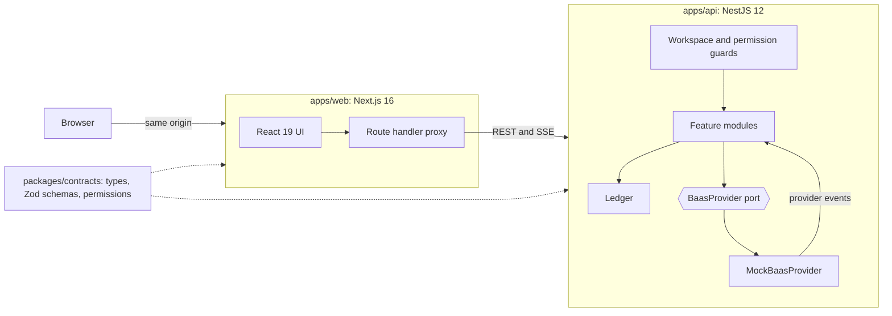

# Post Oak Business Banking

A full-stack banking dashboard concept for **The Post Oak Group**, built as a technical case study.

Every account, person and transaction is fictional. Nothing here touches a real bank, and it is not an official Post Oak product.

## The idea

A generic dashboard would show balances. This one starts from who Post Oak is: a Houston investment bank serving the middle market, with M&A and capital markets advisory under one roof.

So the product treats everyday banking data as an asset. The same ledger that runs payments also answers what a deal team asks first, and turns the client's operating account into the start of an advisory relationship. That is the **Capital** page: five pillars of readiness, drawn from the firm's own column, calculated live from accounts, invoices and receipts.

The brand comes straight from [postoakgroup.co](https://www.postoakgroup.co): forest green `#193E2C`, charcoal `#231F20`, Garamond headings and an Avenir-style body, using EB Garamond and Nunito Sans as open equivalents. The column's flutes became the texture of the interface, and every payment closes with a deal **tombstone**, the framed notice banks use for completed transactions.

## What is inside

| Area                | What it does                                                                                                  |
| ------------------- | ------------------------------------------------------------------------------------------------------------- |
| **Overview**        | Total cash with a scrubbable chart, an action queue, cash flow and spend                                      |
| **Transactions**    | Search, filters, sorting and infinite scroll, all in the URL, plus CSV export, categories, memos and receipts |
| **Payments**        | ACH, wire, instant and internal transfers, with a server-side quote, dual approval and a live lifecycle       |
| **Cards**           | Issue physical and virtual cards, freeze them, and set limits and merchant controls                           |
| **Bills**           | Vendor bills paid through the same approval rules as any payment                                              |
| **Invoices**        | Live invoice builder, reminders, aging report, and receipts that post to the ledger                           |
| **Insights**        | Daily cash forecast with what-if levers, cash flow and spend reporting                                        |
| **Capital**         | Readiness score, indicative value range and advisor requests                                                  |
| **Team & controls** | Roles, a permission matrix, approval policies and an audit log                                                |

Also included: a command palette (`Ctrl K`) with search and plain-English questions, a live event stream, light and dark themes, and a responsive layout with mobile navigation.

### Try this first

1. Open **Send money** and send a wire over $25,000 to anyone. It stops for approval.
2. Choose **Review as Marcus Reed** and approve it, then watch it settle.
3. On **Cards**, freeze a card. The next simulated swipe on it is declined.
4. Press `Ctrl K` and ask: _How much did we spend on fuel last month?_
5. In **Insights**, add a $3M outflow and slip collections by 15 days. Watch the floor check.

## Architecture



```text
apps/
  api/                 NestJS API
    src/baas/          Provider port, mock adapter, live activity simulator
    src/common/        Guards, RFC 9457 errors, idempotency, validation
    src/core/          Ledger, sandbox store, realtime, audit
    src/modules/       One folder per domain
    src/seed/          Deterministic 14-month data generator
  web/                 Next.js app
    src/app/           Routes and the backend-for-frontend proxy
    src/components/    Design system, charts, app shell, brand
    src/features/      One folder per domain
packages/
  contracts/           The single source of truth for both apps
```

## Engineering decisions

| Decision                     | Why                                                                                                                                  |
| ---------------------------- | ------------------------------------------------------------------------------------------------------------------------------------ |
| **Integer cents everywhere** | Floats never touch a balance. Formatting happens at the edge.                                                                        |
| **One ledger service**       | Every balance change goes through it, and tests assert that running balances reconcile.                                              |
| **`BaasProvider` port**      | The domain never talks to a provider directly. Going live means one new adapter and one changed line in `app.module.ts`.             |
| **Maker-checker in the API** | Nobody approves their own payment, whatever their role. The UI reflects this but does not enforce it.                                |
| **Idempotency keys**         | A retry or double-click replays the first response rather than creating a second payment.                                            |
| **Server-side quotes**       | Fees, cut-offs, arrival dates and required approvals are calculated by the API, so the review screen cannot drift from what happens. |
| **Sandbox per visitor**      | Reviewers can move money freely without seeing each other's changes. Bounded by an idle TTL and an LRU cap.                          |
| **Server-Sent Events**       | The data flows one way, passes through proxies cleanly and reconnects on its own. Events tell the client which caches to refresh.    |
| **Backend-for-frontend**     | The browser talks to one origin, so there is no CORS and the sandbox cookie stays `httpOnly`.                                        |
| **Shared contracts**         | Zod schemas validate requests on the server, and the same types drive the UI.                                                        |
| **Hand-built SVG charts**    | D3 for the math, React for the rendering. Scrubbing, keyboard access and the column chart needed full control.                       |

## Specifications

The full specification lives in [`docs/sdd`](docs/sdd/README.md): the brief, the engineering constitution, twelve feature specs with EARS requirements and acceptance criteria, the technical design, verifiable tasks and the verification record. Every requirement traces to code and to the check behind it.

## Going from case study to production

The seams are in place, but this is a prototype. Production would need real authentication and MFA, Postgres behind the workspace store, a real BaaS adapter with signed webhooks, KYB onboarding, PCI-scoped card data through the provider's vault, rate limiting, and observability. The mobile apps would reuse `packages/contracts`.

## Stack

Next.js 16, React 19, TypeScript, Tailwind CSS 4, TanStack Query, Motion, Radix UI, D3 scales and shapes, nuqs, cmdk. NestJS 12, Zod, Swagger, RxJS. Vitest and Supertest. A pnpm workspace.

## AI-assisted development

Built with **Claude Code**, working from a written brief and reviewing the result at each stage. It was used for brand research, architecture, implementation, tests and browser-based verification of every flow. The product decisions and the final review are mine.

## Run it locally

Requires Node 22.12 or newer and pnpm 10.

```bash
pnpm install
pnpm dev
```

The app runs on [localhost:3000](http://localhost:3000) and the API on port 4000, with Swagger at [localhost:3000/docs](http://localhost:3000/docs).

```bash
pnpm test        # unit and API end-to-end tests
pnpm lint
pnpm typecheck
pnpm build
```

## Deploy on Railway

**One service (fastest).** Create a service from this repository with no root directory. Railway installs with pnpm, runs `pnpm build`, then `pnpm start`, which runs the API and the web app together. Generate a public domain and you are done.

**Two services.** Each app ships a `railway.json`.

1. Import the repository. Railway stages a service per deployable package. Remove the one for `contracts` if it appears.
2. Name the services `api` and `web`, and generate a public domain for both.
3. On `web`, set `API_URL` to `https://${{api.RAILWAY_PUBLIC_DOMAIN}}`.

If a service does not pick up its file, set **Config-as-code path** to `/apps/api/railway.json` or `/apps/web/railway.json`.

Sandboxes live in memory, so keep the API at one replica.

---

Prepared by Nicolas Lahoz for The Post Oak Group.
