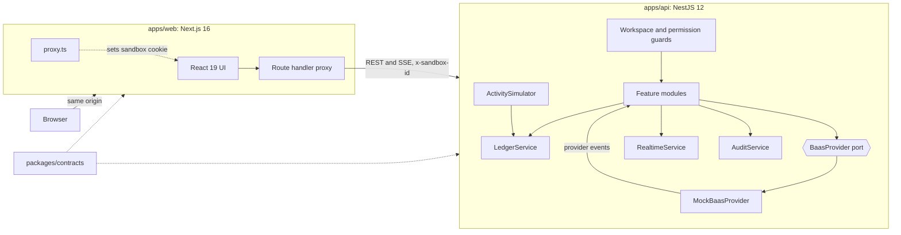
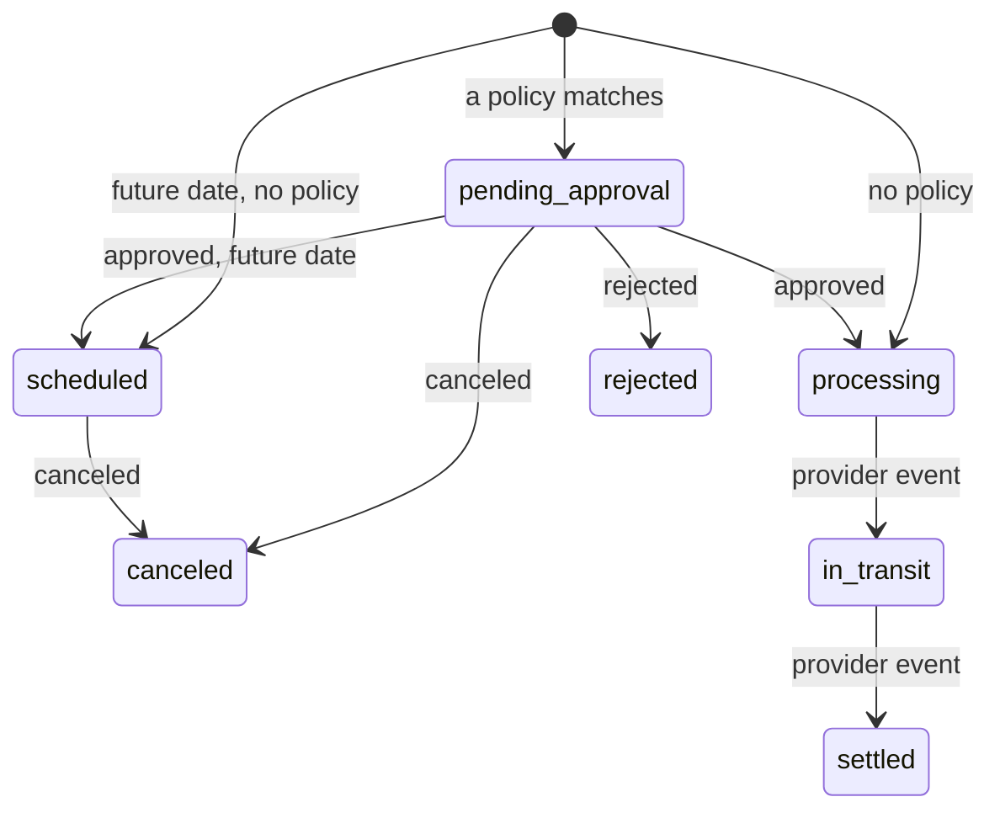
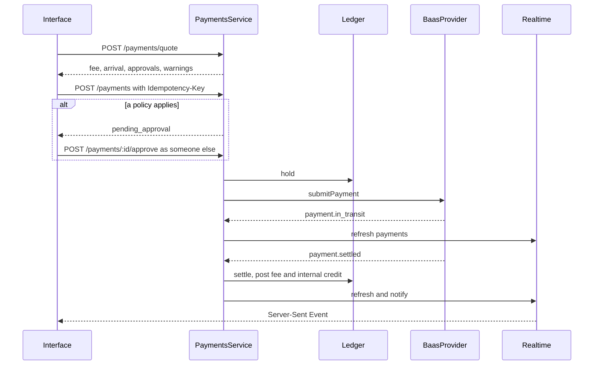

# Technical design

## System



| Part                 | Responsibility                                                                  |
| -------------------- | ------------------------------------------------------------------------------- |
| `packages/contracts` | Domain types, Zod schemas, the permission model, shared validation              |
| `apps/api`           | Business rules, ledger, approvals, reporting, the provider boundary             |
| `apps/web`           | Interface, charts, URL state, and the proxy that hides the API from the browser |

## API layers

```text
Controller   Declares the route, its permission and its schema. No logic.
Service      Business rules. Takes a Workspace explicitly, so it is easy to test.
Ledger       The only code that changes a balance.
Workspace    Plain data for one sandbox. The seam a database would replace.
Port         What the domain needs from a banking provider.
```

Guards run in order: `WorkspaceGuard` resolves the sandbox and acting user, then `PermissionsGuard` checks `@RequirePermission()`. Services receive the workspace and actor as arguments rather than through request scope, which keeps them singletons and keeps tests simple.

## Data model

Entities live in `packages/contracts/src`. Derived values are computed on read so they can never drift.

| Entity           | Key fields                                                      | Derived on read                              |
| ---------------- | --------------------------------------------------------------- | -------------------------------------------- |
| `Account`        | `kind`, `balance`, `apyBps`                                     | `available`, `pending`, `change30d`, `trend` |
| `Transaction`    | `amount` (signed), `rail`, `status`, `category`, `balanceAfter` |                                              |
| `Payment`        | `rail`, `amount`, `fee`, `status`, `decisions`, `timeline`      |                                              |
| `Recipient`      | `bankName`, `defaultRail`, `isNew`, `totalPaid`                 |                                              |
| `Card`           | `limit`, `controls`, `status`, `design`                         | `spent`, `lastUsedAt`, `holderName`          |
| `Bill`           | `dueOn`, `status`, `paymentId`                                  | `isOverdue`                                  |
| `Invoice`        | `lines`, `total`, `status`                                      | `isOverdue`, `daysOverdue`                   |
| `ApprovalPolicy` | `rails`, `threshold`, `onlyNewRecipients`, `enabled`            |                                              |

## Payment lifecycle





## Live data

The API publishes a `RealtimeEvent` naming the client caches it invalidates, and optionally a notification. The web app holds one `EventSource`, invalidates those TanStack Query scopes and shows a toast. Nothing in the client needs to understand each event type.

`ActivitySimulator` stands in for webhooks. It runs only for sandboxes with a browser connected, and its card swipes obey the card's current state, so a freeze has a visible effect.

## Web app

- **Routes** are thin server components that render a client view from `src/features`.
- **Pages are static.** Each ships a prerendered shell, and data loads through TanStack Query behind skeletons shaped like the final layout.
- **Filters live in the URL** through `nuqs`, so views are shareable and survive a reload.
- **The design system** in `src/components/ui` wraps Radix primitives. Charts in `src/components/charts` use D3 for math and React for rendering.

## Decisions

| #   | Decision                                           | Why                                                                                            | Trade-off                                                           |
| --- | -------------------------------------------------- | ---------------------------------------------------------------------------------------------- | ------------------------------------------------------------------- |
| D1  | pnpm workspace, no Turborepo                       | Topological builds through `pnpm --filter` are enough for three packages                       | No remote cache                                                     |
| D2  | NestJS API behind a mock provider                  | Mirrors the production shape, so the prototype is a true first slice                           | More code than Next route handlers alone                            |
| D3  | In-memory sandbox per visitor                      | Isolation with no database and nothing to clean up                                             | One API replica. State ends on restart                              |
| D4  | Seed anchored to today, deterministic PRNG         | "Last 30 days" always means what it says, and every sandbox tells the same story               | Figures change slowly from day to day                               |
| D5  | Server-Sent Events over WebSockets                 | One-way data, works through proxies, reconnects by itself                                      | Client actions stay on REST                                         |
| D6  | Route handler proxy over rewrites                  | Reads `API_URL` at runtime and streams SSE. Rewrites resolve at build time                     | One extra hop                                                       |
| D7  | Static pages with client data over server fetching | Sessions are per visitor, and the shell paints immediately                                     | A brief skeleton on the first load                                  |
| D8  | Cache Components off                               | Every view is per-session, so a static shell plus client data does the job with less machinery | No route state kept between navigations                             |
| D9  | Hand-built SVG charts over a chart library         | Scrubbing, keyboard access and the column chart needed full control                            | More code to own                                                    |
| D10 | Rule-based assistant over an LLM                   | No key needed, and it cannot invent a number                                                   | Limited to known intents. An LLM can sit in front of the same tools |
| D11 | Personas over a login                              | A reviewer lands on data, and can compare roles in seconds                                     | Not a security boundary. Real auth replaces `WorkspaceGuard`        |
| D12 | Monogram avatars over merchant logos               | No third-party trademarks to license                                                           | Less recognition at a glance                                        |

## Deployment

`web` and `api` are separate apps, and the repository supports two layouts:

| Layout       | How it runs                                                                     | Configuration      |
| ------------ | ------------------------------------------------------------------------------- | ------------------ |
| Two services | Each app deploys on its own, from its `railway.json`                            | `API_URL` on `web` |
| One service  | `scripts/start-all.mjs` starts both. `web` takes `PORT`, the API stays internal | None               |

There are only two environment variables, `API_URL` and `PORT`, and no secrets, because there is no database and no real provider key. `API_URL` is read at runtime, so a build can move between environments unchanged. Keep the API at one replica, since sandboxes live in its memory.

## From here to production

| Seam                        | Replace with                                                      |
| --------------------------- | ----------------------------------------------------------------- |
| `WorkspaceGuard`            | Session authentication, MFA and tenant resolution                 |
| `WorkspaceStore`            | Postgres repositories with transactional ledger writes            |
| `MockBaasProvider`          | A provider adapter, with signed webhooks feeding the same handler |
| `ActivitySimulator`         | Removed, as real webhooks take over                               |
| In-memory idempotency store | A durable key store with expiry                                   |
| Card reveal                 | The provider's PCI vault, so card data never reaches this system  |
| Rule-based assistant        | An LLM calling the same read-only tools                           |
